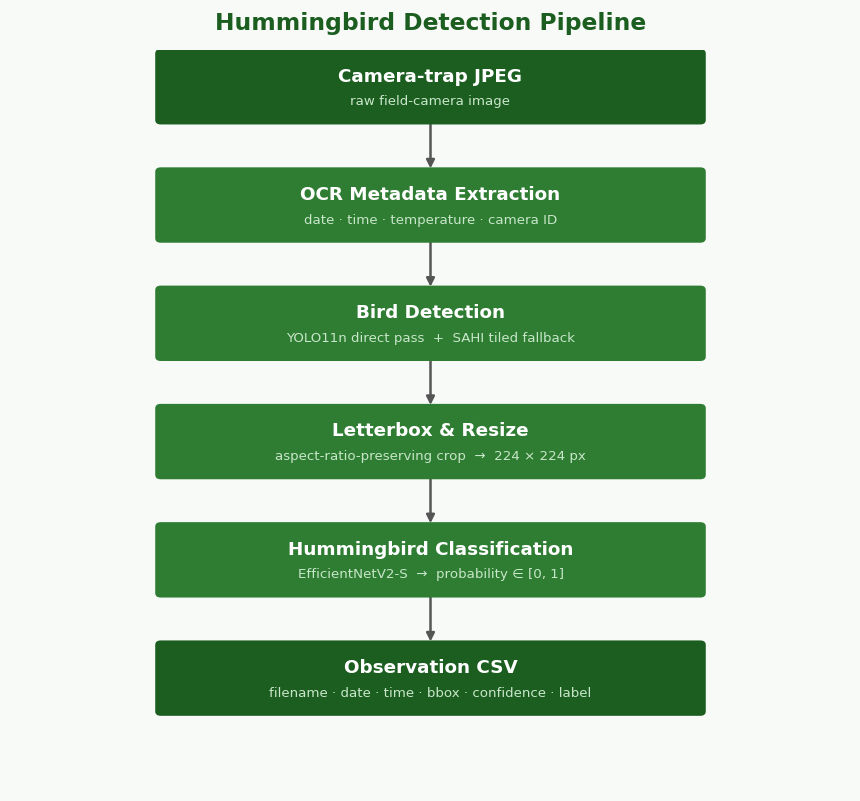
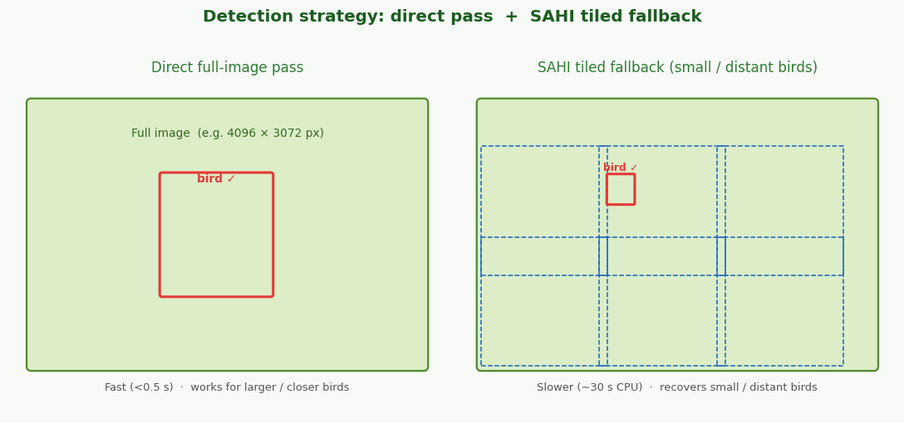
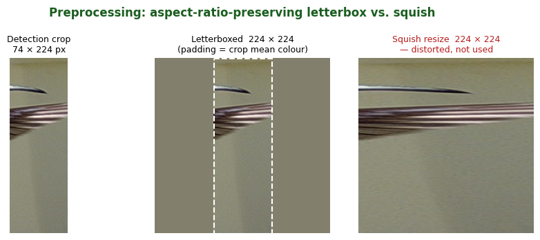

# Architecture

The pipeline transforms a raw camera-trap image into a structured record that answers: *is there a hummingbird in this photo, and if so where?*



## Pipeline stages

```
Raw image
    │
    ▼
┌─────────────────────┐
│  OCR metadata strip │  easyocr reads temperature, date/time from the bottom strip
└────────┬────────────┘
         │ margin_px crop removed before detection
         ▼
┌─────────────────────────────────────────────────────┐
│   Bird detection                                    │
│   1. Direct YOLO pass on full image (fast path)     │
│   2. SAHI tiling fallback if direct pass misses     │
│      overlapping tiles → NMS merge → bbox list      │
└────────┬────────────────────────────────────────────┘
         │ one bounding-box crop per detected bird
         │ (letterboxed to square before resize)
         ▼
┌─────────────────────┐
│  Hummingbird        │  EfficientNetV2-S binary classifier
│  classification     │  outputs probability ∈ [0, 1]
└────────┬────────────┘
         │
         ▼
Structured record (CSV row)
  filename, timestamp, temperature,
  bbox, confidence, is_hummingbird
```

## The camera-trap metadata strip

Camera-trap images often contain a burned-in status strip at the bottom (temperature, date/time, moon phase, sequence number). The `margin_px` setting tells the pipeline where this strip starts so it is cropped away before detection — otherwise the OCR digits can trigger false bird detections.

## Detection strategy: direct pass + SAHI tiling

Bird detection uses a two-stage strategy controlled by `detector.slice_size` in `pipeline.yaml`:



1. **Direct full-image pass** — YOLO runs on the full (margin-stripped) image first. If any birds are found, those detections are returned immediately. This is fast (< 0.5 s) and handles birds that are large enough to be visible at YOLO's 640 px input resolution (typically birds close to the camera, ≥ 500 px in the original image).

2. **SAHI tiled fallback** — If the direct pass finds nothing, SAHI (Slicing Aided Hyper Inference) divides the image into overlapping tiles, runs YOLO on each tile, and merges detections with NMS. This recovers small distant birds (≈ 15 px after YOLO downscale) at the cost of higher inference time (~34 s on CPU).

When `slice_size` is `None`, only the direct pass is used (suitable for small pre-cropped inputs or fast-mode operation).

### Limitation: very large objects

SAHI NMS merges detections by IoU. When a bird is *larger* than the tile size (e.g. a bird very close to the camera, spanning multiple tiles), adjacent tile detections have low IoU (≈ 0.11 for a 4130 × 2350 px bird in 1280 px tiles) and are never merged. The direct pass handles this regime correctly because the bird maps to ≈ 300 × 170 px at YOLO's 640 px input — well above the detection floor.

## Aspect-ratio-preserving crop

Each detected bounding box is cropped from the image and resized to 224 × 224 for the classifier. Before resizing, the crop is **letterboxed** to a square by padding the shorter dimension with the per-channel mean colour of the crop. This ensures the aspect ratio of the detection is preserved regardless of its shape (e.g. a tall narrow 208 × 640 px SAHI sliver would otherwise be stretched ~3 × horizontally, producing an unrecognisable input for the classifier).



## Detect-then-classify architecture

A two-stage design (detect then classify) is more robust than a single-stage hummingbird detector for this dataset because:

- YOLO11n pre-trained on COCO already detects birds reliably with no fine-tuning.
- The binary classifier can be re-trained quickly on a small, domain-specific dataset without affecting detection quality.
- Separating the stages makes evaluation and debugging easier — detection failures and classification failures have different diagnostics.

## Two-phase fine-tuning

The classifier is fine-tuned in two phases:

| Phase | Epochs | Weights updated | Learning rate |
|-------|--------|----------------|---------------|
| 1 (head) | 1–5 | Classification head only | `lr` |
| 2 (full) | 6+ | All weights | `lr/10`, cosine annealed to 0 |

Freezing the backbone in phase 1 prevents catastrophic forgetting of ImageNet features while the new head converges. Full fine-tuning in phase 2 adapts low-level features to camera-trap image characteristics.

## Post-processing pipeline

After the four detection/classification stages, two post-processing steps enrich the observation records:

### Motion-event deduplication

Successive images captured within a configurable time window (default 18 s) of the same event are flagged as duplicates. The first image anchors the window; subsequent images within it receive `is_duplicate=True` but do not advance the reference timestamp.

### Composition-based suspected duplicates

Photos taken in the same clock minute at the same camera with the same bird-composition signature — (num_hummingbirds, num_other) — are grouped. Among *N* photos with identical composition, only `ceil(N / 3)` are considered independent observations; the remainder are flagged as `is_suspected_duplicate`. This guards against burst-mode camera captures where multiple near-identical frames are triggered by the same bird visit.

The rule encodes:

| Photos (N) | Kept | Flagged |
|------------|------|---------|
| 1 | 1 | 0 |
| 2–3 | 1 | 1–2 |
| 4–6 | 2 | 2–4 |
| 7–9 | 3 | 4–6 |

## Analysis and reporting

The analysis module produces comprehensive summaries from the detection CSV:

- **Camera efficiency** — ratio of photos with birds to total photos processed per camera, with blank-image counts.
- **Temporal distribution** — hourly and daily activity histograms split by hummingbird vs. other birds, both globally and per camera.
- **Confidence statistics** — detection and classification confidence distributions, plus Pearson correlation between the two.
- **Duplicate statistics** — counts and rates for both motion-event and composition-based duplicates.

Results are available as a terminal report (`generate_report`), a machine-readable JSON bundle (`export_summary_json`), and publication-quality PNG plots (`generate_plots`).

### Output files

`process_directory` writes two CSVs: a **bird-level** CSV (one row per detected bird, with post-processed flags and bounding-box coordinates) and a **per-photo** CSV (one row per photo, aggregating bird counts, confidence means/maximums, and duplicate flags). Long runs support incremental writes (immediate `.partial.csv` sidecar) and resume (`--resume` flag) — see the [how-to guide](../how-to/run-pipeline.md).
