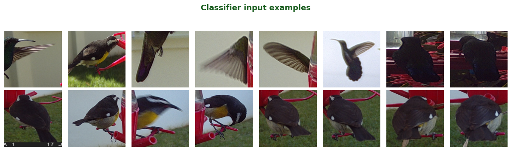

# Hummingbird Detection

**Automated hummingbird identification from wildlife camera-trap images.**

This package provides a complete pipeline for detecting and classifying hummingbirds in JPEG images from field camera traps. It combines YOLO11n bird detection with a fine-tuned EfficientNetV2-S binary classifier, and extracts metadata (date, time, temperature, camera ID) directly from the OCR strip burned into each image.

---

## How it works

The pipeline transforms every camera-trap JPEG into a structured observation record through four main stages:


1. **OCR metadata extraction** — reads the burned-in timestamp and temperature from the bottom strip
2. **Bird detection** — YOLO11n locates every bird bounding box; a SAHI tiled fallback recovers small, distant birds
3. **Letterbox & resize** — each crop is padded to a square and resized to 224 × 224 px without distortion
4. **Hummingbird classification** — EfficientNetV2-S outputs a probability score; results are written to CSV

---

## Quick start

```bash
git clone https://github.com/rgutzen/Humming_Bird_Detection
cd Humming_Bird_Detection
conda env create -f environment.yml && conda activate humming_bird_detection
pip install -e .
```

```python
from humming_bird_detection.config import load_config
from humming_bird_detection.models.detector import build_detector
from humming_bird_detection.models.classifier import build_classifier
from humming_bird_detection.workflow.pipeline import process_directory

cfg        = load_config()
detector   = build_detector(cfg)
classifier = build_classifier(cfg)

df = process_directory("path/to/images/", "output/observations.csv",
                       detector, classifier, cfg)
```

---

## Example output

| filename | date | time | camera | is_hummingbird | classification_confidence |
|---|---|---|---|---|---|
| WSCT0025_001.JPG | 2024-06-15 | 08:32:14 | WSCT0025 | True | 0.94 |
| WSCT0025_002.JPG | 2024-06-15 | 08:33:01 | WSCT0025 | False | 0.12 |

---

## What the classifier sees

Hummingbirds share the feeder with other bird species. The classifier distinguishes them from the 224 × 224 px crops produced by the detector.



---

## Documentation

This documentation follows the [Diátaxis](https://diataxis.fr) framework.

| | Learn | Solve a problem |
|---|---|---|
| **Practical** | [Tutorial](tutorials/getting-started.md) — guided first run | [How-to guides](how-to/run-pipeline.md) — task recipes |
| **Theoretical** | [Explanation](explanation/architecture.md) — how it works | [Reference](reference/config.md) — complete specs |
