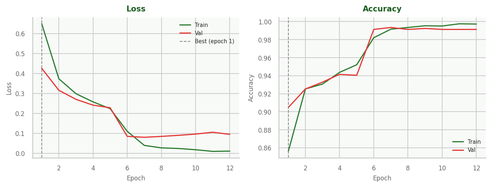
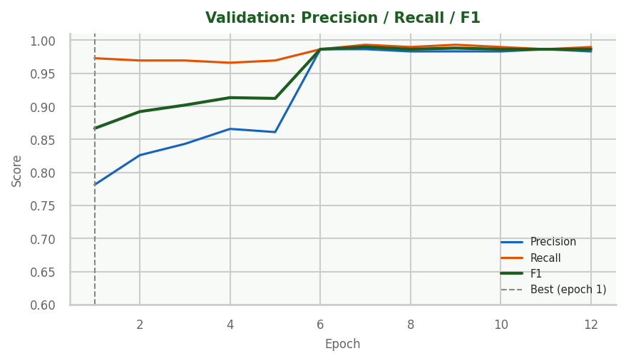
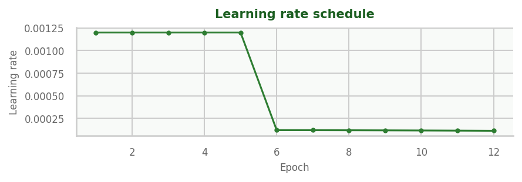
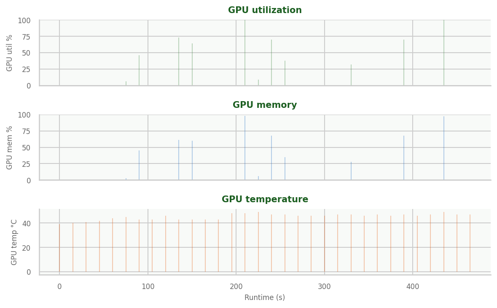
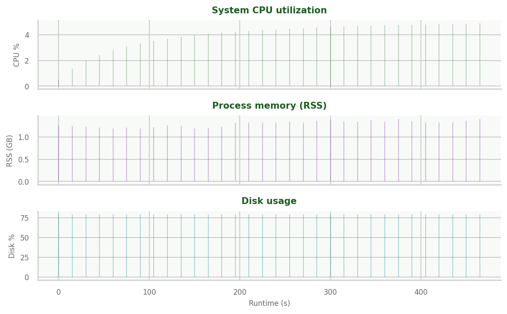

# Training Report — hummingbird_classifier_20260430_193523

**Generated:** 2026-05-03 11:49:08  
**W&B Run:** [lnjepxc0](https://wandb.ai/rgutzen/hummingbird-detection/runs/lnjepxc0)  
**Project:** `hummingbird-detection`  
**Git commit:** `13516d69`  
**SLURM Job ID:** 7655232

---

## Compute Resources

| Resource | Value |
|----------|-------|
| Host | `gl024.hpc.nyu.edu` |
| GPU | NVIDIA L40S ×1 |
| GPU memory | 48.3 GB |
| CUDA cores | 18176 |
| Architecture | Ada |
| CPU cores | 128 |
| RAM | 540.2 GB |
| Partition | `l40s_public` |
| QoS | `gpu48` |

---

## Hyperparameters

| Parameter | Value |
|-----------|-------|
| Epochs (requested) | 50 |
| Epochs (completed) | 12 |
| Batch size | 128 |
| Learning rate | 0.0012 |
| Weight decay | 0.0001 |
| Early stopping patience | 5 |
| Seed | 42 |
| Train dir | `data/interim/train_data/train` |
| Val dir | `data/interim/train_data/val` |

## Best Result

| Metric | Value | Epoch |
|--------|-------|-------|
| Best val loss | 0.0804 | 7 |
| Val accuracy at best | 0.9935 | 7 |
| Val precision at best | 0.9865 | 7 |
| Val recall at best | 0.9932 | 7 |
| Val F1 at best | 0.9898 | 7 |
| Training duration | 7m 45s | — |

## Final Epoch Metrics

| Metric | Value |
|--------|-------|
| Train loss | 0.0112 |
| Train accuracy | 0.9973 |
| Val loss | 0.0952 |
| Val accuracy | 0.9913 |
| Val precision | 0.9831 |
| Val recall | 0.9898 |
| Val F1 | 0.9864 |

---

## Model Metrics







---

## System Metrics





---

## Per-Epoch Training Log

```text
2026-04-30 15:36:20,817 [INFO] humming_bird_detection.models.classifier — Epoch 1/50  lr=1.20e-03  train_loss=0.6492  train_acc=0.856  val_loss=0.4259  val_acc=0.905  val_prec=0.781  val_rec=0.973  val_f1=0.867  ← best
2026-04-30 15:36:55,242 [INFO] humming_bird_detection.models.classifier — Epoch 2/50  lr=1.20e-03  train_loss=0.3737  train_acc=0.925  val_loss=0.3160  val_acc=0.925  val_prec=0.826  val_rec=0.969  val_f1=0.892  ← best
2026-04-30 15:37:30,386 [INFO] humming_bird_detection.models.classifier — Epoch 3/50  lr=1.20e-03  train_loss=0.2991  train_acc=0.931  val_loss=0.2707  val_acc=0.933  val_prec=0.843  val_rec=0.969  val_f1=0.902  ← best
2026-04-30 15:38:08,041 [INFO] humming_bird_detection.models.classifier — Epoch 4/50  lr=1.20e-03  train_loss=0.2579  train_acc=0.944  val_loss=0.2415  val_acc=0.941  val_prec=0.866  val_rec=0.966  val_f1=0.913  ← best
2026-04-30 15:38:42,769 [INFO] humming_bird_detection.models.classifier — Epoch 5/50  lr=1.20e-03  train_loss=0.2240  train_acc=0.952  val_loss=0.2286  val_acc=0.940  val_prec=0.861  val_rec=0.969  val_f1=0.912  ← best
2026-04-30 15:39:25,020 [INFO] humming_bird_detection.models.classifier — Epoch 6/50  lr=1.20e-04  train_loss=0.1105  train_acc=0.982  val_loss=0.0852  val_acc=0.991  val_prec=0.986  val_rec=0.986  val_f1=0.986  ← best
2026-04-30 15:40:03,889 [INFO] humming_bird_detection.models.classifier — Epoch 7/50  lr=1.19e-04  train_loss=0.0399  train_acc=0.992  val_loss=0.0804  val_acc=0.993  val_prec=0.986  val_rec=0.993  val_f1=0.990  ← best
2026-04-30 15:40:45,641 [INFO] humming_bird_detection.models.classifier — Epoch 8/50  lr=1.19e-04  train_loss=0.0275  train_acc=0.994  val_loss=0.0850  val_acc=0.991  val_prec=0.983  val_rec=0.990  val_f1=0.986
2026-04-30 15:41:27,829 [INFO] humming_bird_detection.models.classifier — Epoch 9/50  lr=1.18e-04  train_loss=0.0244  train_acc=0.995  val_loss=0.0903  val_acc=0.992  val_prec=0.983  val_rec=0.993  val_f1=0.988
2026-04-30 15:42:11,918 [INFO] humming_bird_detection.models.classifier — Epoch 10/50  lr=1.16e-04  train_loss=0.0181  train_acc=0.995  val_loss=0.0965  val_acc=0.991  val_prec=0.983  val_rec=0.990  val_f1=0.986
2026-04-30 15:42:54,786 [INFO] humming_bird_detection.models.classifier — Epoch 11/50  lr=1.15e-04  train_loss=0.0099  train_acc=0.998  val_loss=0.1058  val_acc=0.991  val_prec=0.986  val_rec=0.986  val_f1=0.986
2026-04-30 15:43:37,832 [INFO] humming_bird_detection.models.classifier — Epoch 12/50  lr=1.13e-04  train_loss=0.0112  train_acc=0.997  val_loss=0.0952  val_acc=0.991  val_prec=0.983  val_rec=0.990  val_f1=0.986
```
